# kindric



kindric shows the Claude Code sessions of all your accounts in one window, side by side. Sessions can leave each other short messages, even across accounts.

It comes with [kindric-accounts](crates/accounts/README.md), which runs each account with its own login and one shared setup. Both live in this repository.

## Features

- **Every account in one place.** Sessions from all your kindric-accounts accounts, plus your plain `~/.claude` setup, with their state.
- **Real sessions in panes.** Each pane is a live Claude Code session. Split, switch, drag the separators.
- **Projects as tabs.** One tab per folder, with the sessions working in it.
- **Messages between sessions.** A small MCP server lets sessions list each other and leave messages.
- **Nothing to lose.** Sessions are Claude Code background sessions. Close kindric, they keep running.

Two interfaces share the same core:

| Binary | Role |
| --- | --- |
| `kindric-desktop` | The desktop app. The main one, where new features go. |
| `kindric` | The terminal interface, for machines without a display (over SSH). Frozen, but built and tested. It also runs the MCP server for messages. |

## Install

You need Rust, and Claude Code with background sessions (tested with 2.1.312). kindric is used daily on Linux; CI builds and tests it on Linux, macOS and Windows.

```sh
git clone https://github.com/LouisStani/kindric.git
cargo install --locked --path kindric/crates/accounts
cargo install --locked --path kindric/crates/tui
cargo install --locked --path kindric/crates/desktop
```

Binaries go to `~/.cargo/bin`, which must be on your `PATH`. Install `kindric` even if you only use the desktop app: it runs the messages server. kindric-accounts alone can be installed without Rust: see [its README](crates/accounts/README.md#installation).

On Linux, the desktop app needs WebKitGTK 4.1 (`webkit2gtk-4.1` on Arch, `libwebkit2gtk-4.1-dev` on Debian and Ubuntu).

## Get started

```sh
kindric-desktop
```

On first launch, the app lists what is left to set up, with the command to copy for each step. Press `F1` to see that list again.

To let sessions send messages, add the MCP server once (the app has a button that does it for you):

```sh
kindric-accounts run <account> mcp add -s user kindric -- kindric mcp   # shared with all your accounts
claude mcp add -s user kindric -- kindric mcp                           # for plain ~/.claude
```

Only sessions started after this get it.

## Main shortcuts

| Key | Effect |
| --- | --- |
| `Ctrl+N` | Start a new session |
| `Ctrl+P` | Find a session |
| `Ctrl+Shift+D` | Split the pane |
| `Ctrl+H` / `Ctrl+L` | Previous / next pane |
| `Ctrl+Shift+T` | Add a project tab |
| `Alt+1` … `Alt+9` | Open chip n of the bar (`Alt+1` is the session that needs you most) |
| `F1` | Setup checklist and every shortcut |

On macOS, `Cmd` replaces `Ctrl`.

## Documentation

| Page | What is in it |
| --- | --- |
| [Desktop app](docs/desktop.md) | Tabs, the session bar, panes, all shortcuts, themes |
| [Terminal interface](docs/terminal.md) | Keys and session states of `kindric` |
| [Messages](docs/messages.md) | How sessions talk, isolated accounts, where messages are stored |
| [How it works](docs/how-it-works.md) | Internals and known limits |
| [Development](docs/development.md) | Workspace layout, tests, tracing, icon |
| [kindric-accounts](crates/accounts/README.md) | The account manager |

## Contributing

Read [CONTRIBUTING.md](CONTRIBUTING.md) before contributing and [SECURITY.md](SECURITY.md) to report a vulnerability.

## License

[GPL-3.0-only](LICENSE). You can use, change and share kindric, including inside a company. If you distribute it, changed or not, you must share its source under the same license. Versions before the change keep their CC BY-NC-SA 4.0 license.
