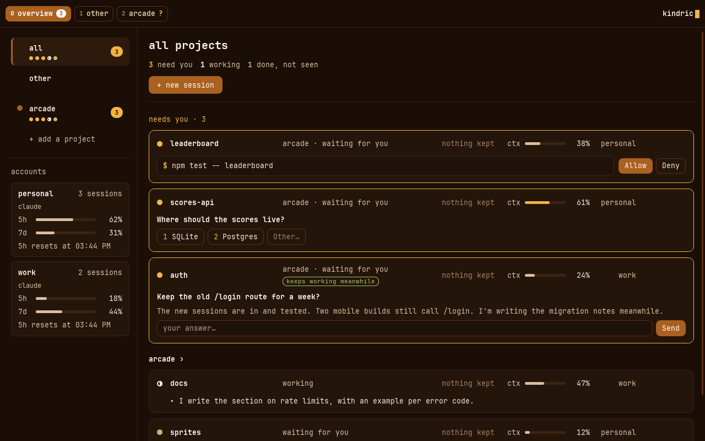

# kindric

[](https://github.com/LouisStani/kindric/actions/workflows/ci.yml)



kindric shows the Claude Code sessions of all your accounts in one window, side by side. Sessions can leave each other short messages, even across accounts.



It comes with [kindric-accounts](crates/accounts/README.md), which runs each account with its own login and one shared setup. Both live in this repository.

## Features

- **Every account in one place.** Sessions from all your kindric-accounts accounts, plus your plain `~/.claude` setup, with their state.
- **Real sessions in panes.** Each pane is a live Claude Code session. Split, switch, drag the separators.
- **Projects as tabs.** One tab per folder, with the sessions working in it.
- **A control center.** One page with every session: what each one does, what needs you. Answer a permission or a question there without opening the session.
- **Messages between sessions.** A small MCP server lets sessions list each other, leave messages and wake each other up.
- **Files kept for you.** Sessions keep the pages, images and reports they made for you, by project. kindric also shows the files each session changed and the worktrees of a project.
- **Away mode.** Tell a session you are away for an hour: it keeps working without waiting for your approval, and its commands that push, merge, delete or install are refused.
- **Any model, Codex and OpenCode.** An account can take its model from an Anthropic API key, OpenRouter, a local Ollama or another gateway, or run OpenAI's Codex or OpenCode instead of Claude Code. See [Accounts without a Claude login](crates/accounts/README.md#accounts-without-a-claude-login), [Codex accounts](docs/desktop.md#codex-accounts) and [OpenCode accounts](docs/desktop.md#opencode-accounts).
- **Nothing to lose.** Sessions are Claude Code background sessions, sessions of the Codex daemon, or sessions of an OpenCode service. Close kindric, they keep running.

Two interfaces share the same core:

| Binary | Role |
| --- | --- |
| `kindric-desktop` | The desktop app. The main one, where new features go. |
| `kindric` | The terminal interface, for machines without a display (over SSH). Frozen, but built and tested. It also runs the MCP server and the hooks of the sessions. |

## Install

You need Rust, and Claude Code with background sessions (tested with 2.1.312). Codex and OpenCode are needed only for their own accounts (tested with Codex 0.171.0 and OpenCode 2.3.2). kindric is used daily on Linux; CI builds and tests it on Linux, macOS and Windows.

```sh
git clone https://github.com/LouisStani/kindric.git
cargo install --locked --path kindric/crates/accounts
cargo install --locked --path kindric/crates/tui
cargo install --locked --path kindric/crates/desktop
```

Binaries go to `~/.cargo/bin`, which must be on your `PATH`. Install `kindric` even if you only use the desktop app: it runs the messages server and the hooks that kindric-accounts gives the sessions. kindric-accounts alone can be installed without Rust: see [its README](crates/accounts/README.md#installation).

On Linux, the desktop app needs WebKitGTK 4.1 (`webkit2gtk-4.1` on Arch, `libwebkit2gtk-4.1-dev` on Debian and Ubuntu).

## Get started

```sh
kindric-desktop
```

On first launch, the app lists what is left to set up, with the command to copy for each step. Press `F1` to see that list again. Once you have sessions, the list no longer covers the control center: a line at its top says how many steps are left and opens it.

To let sessions send messages, add the MCP server once (the app has a button that does it for you):

```sh
kindric-accounts run <account> mcp add -s user kindric -- kindric mcp   # shared with all your accounts
claude mcp add -s user kindric -- kindric mcp                           # for plain ~/.claude
```

Only sessions started after this get it.

## Main shortcuts

| Key | Effect |
| --- | --- |
| `Ctrl+N` | Start a new session |
| `Ctrl+P` | Find a session |
| `Ctrl+Shift+D` | Split the pane |
| `Ctrl+H` / `Ctrl+L` | Previous / next pane |
| `Ctrl+Shift+T` | Add a project tab |
| `Ctrl+Shift+0` | Control center |
| `Alt+1` … `Alt+9` | Open chip n of the bar (`Alt+1` is the session that needs you most) |
| `F3` | Usage: limits and tokens |
| `F4` | Stats: graphs and records |
| `F1` | Setup checklist and every shortcut |

On macOS, `Cmd` replaces `Ctrl`.

## Documentation

| Page | What is in it |
| --- | --- |
| [Desktop app](docs/desktop.md) | Tabs, the control center, the session bar, panes, away mode, changed files, worktrees, artifacts, settings, all shortcuts, themes |
| [Terminal interface](docs/terminal.md) | Keys and session states of `kindric` |
| [Messages](docs/messages.md) | How sessions talk and keep files, isolated accounts, where messages are stored |
| [How it works](docs/how-it-works.md) | Internals and known limits |
| [Development](docs/development.md) | Workspace layout, tests, tracing, icon |
| [kindric-accounts](crates/accounts/README.md) | The account manager |

## Who builds it

kindric is built by [lystriq](https://github.com/LouisStani). He owns the architecture, the major decisions, the interface and the users, and guides the work in the code. The code itself is written with Claude Code.

## Contributing

Read [CONTRIBUTING.md](CONTRIBUTING.md) before contributing and [SECURITY.md](SECURITY.md) to report a vulnerability.

## License

[GPL-3.0-only](LICENSE). You can use, change and share kindric, including inside a company. If you distribute it, changed or not, you must share its source under the same license. Versions before the change keep their CC BY-NC-SA 4.0 license.
