# kindric-accounts



kindric-accounts lives in the [kindric](https://github.com/LouisStani/kindric) repository, in `crates/accounts`. Its binaries are attached to that repository's releases.

Run several Claude Code accounts side by side, each in its own terminal, with a single shared setup.

No more `/logout` and `/login` every time you switch between your personal and work accounts. Pick an account and Claude starts. Your `CLAUDE.md`, skills, agents, plugins and settings come with it.

## Why

Claude Code keeps one login per configuration directory. Switching accounts means logging out and back in, and you cannot keep two accounts open at once.

kindric-accounts gives each account its own directory and links the shared parts back to `~/.claude`. You configure Claude once and every account uses that configuration.

- Keep two accounts open at the same time, in two terminals.
- Share one `CLAUDE.md` and one set of skills, agents, commands, plugins and themes across all accounts, plus the MCP servers you add to any of them.
- Create a shared directory later and existing accounts pick it up on their next launch.
- An account can also take its model from an Anthropic API key, OpenRouter, a local Ollama or any gateway that speaks Anthropic's API. See [Accounts without a Claude login](#accounts-without-a-claude-login).
- An account can run OpenAI's Codex instead of Claude Code. See [Codex accounts](#codex-accounts).
- kindric-accounts never reads, copies or sends your Claude or Codex credentials. The key of an API or gateway account stays in that account's directory and only goes to Claude Code. It makes no network requests: it only talks to the local daemon of a Codex account.
- One self-contained binary for Linux, macOS and Windows. Nothing else to install.

## Installation

You need [Claude Code](https://docs.anthropic.com/en/docs/claude-code) on your `PATH`.

**Linux and macOS.** Download the binary for your system from the latest release:

```sh
# x86_64-unknown-linux-gnu, aarch64-unknown-linux-gnu, x86_64-apple-darwin or aarch64-apple-darwin
target=x86_64-unknown-linux-gnu
curl -fLo "$HOME/.local/bin/kindric-accounts" --create-dirs \
  "https://github.com/LouisStani/kindric/releases/latest/download/kindric-accounts-$target"
chmod +x "$HOME/.local/bin/kindric-accounts"
kindric-accounts --version
```

Make sure `~/.local/bin` is on your `PATH`. Run the same commands again to update.

**Windows** (PowerShell):

```powershell
$dir = "$env:LOCALAPPDATA\Programs\kindric-accounts"
New-Item -ItemType Directory -Force $dir | Out-Null
Invoke-WebRequest -OutFile "$dir\kindric-accounts.exe" `
  https://github.com/LouisStani/kindric/releases/latest/download/kindric-accounts-x86_64-pc-windows-msvc.exe
$userPath = [Environment]::GetEnvironmentVariable('Path', 'User')
[Environment]::SetEnvironmentVariable('Path', "$userPath;$dir", 'User')
```

Open a new terminal, then run `kindric-accounts --version`. Windows support is new: it passes the automated tests but has not been used day to day yet. Please report any problem.

**From source**, with Rust installed:

```sh
cargo install --locked --git https://github.com/LouisStani/kindric kindric-accounts
```

**Upgrading from claude-accounts.** kindric-accounts is claude-accounts under a new name, and its folders are now called `kindric-accounts` too. Move them once, and your accounts keep their logins:

1. Close every Claude Code session started by claude-accounts, background sessions included.
2. Remove the old command (`cargo uninstall claude-accounts`, or the 1.x Bash script), then install this one. Bash, `jq` and `gum` are no longer needed.
3. Move the folders. On Linux and macOS (use your `XDG_CONFIG_HOME` and `XDG_DATA_HOME` if you set them):

   ```sh
   mv ~/.config/claude-accounts ~/.config/kindric-accounts
   mv ~/.local/share/claude-accounts ~/.local/share/kindric-accounts
   ```

   On Windows, in PowerShell:

   ```powershell
   Rename-Item "$env:APPDATA\claude-accounts" kindric-accounts
   ```

4. Plugins installed from an account session are recorded with the old path. Fix it on Linux and macOS with:

   ```sh
   sed -i.bak 's|/claude-accounts/|/kindric-accounts/|g' ~/.claude/plugins/installed_plugins.json ~/.claude/plugins/known_marketplaces.json
   ```

   On Windows, replace `claude-accounts` with `kindric-accounts` in the paths of these two files.

## Quick start

```sh
kindric-accounts add personal
kindric-accounts add work

kindric-accounts run personal   # first launch: run /login inside Claude
```

Each later launch reuses the account you logged in with. Open a second terminal and run the other account at the same time:

```sh
kindric-accounts run work
```

Or just run `kindric-accounts` to open the menu. It shows whether each account is logged in, its plan and how many Claude sessions are open on it. Type to filter, use the arrow keys and Enter to launch, add or remove an account. Escape cancels.

## Commands

| Command | Effect |
| --- | --- |
| `kindric-accounts` | Opens the menu and starts Claude in the current terminal. |
| `kindric-accounts add <name>` | Creates an account and its private directory. |
| `kindric-accounts add <name> --provider <provider> [--url <address>] [--model <name>]` | Creates an account whose model comes from an API key or a gateway. See [Accounts without a Claude login](#accounts-without-a-claude-login). |
| `kindric-accounts add <name> --agent codex` | Creates an account that runs Codex instead of Claude Code. See [Codex accounts](#codex-accounts). |
| `kindric-accounts token <name>` | Keeps the key of such an account, read from standard input (hidden on a terminal). |
| `kindric-accounts list [--json]` | Prints account names, one per line. |
| `kindric-accounts status [--json]` | Shows whether each account is logged in, its plan (`pro`, `max`…) and its active sessions. |
| `kindric-accounts remove <name> [--delete-dir \| --keep-dir]` | Removes an account from the list. Its directory is deleted only after you confirm, or as the option says. |
| `kindric-accounts run <name> [args]` | Starts Claude with this account, or Codex on a Codex account. Extra arguments go to `claude` (or `codex`), for example `--resume`. |
| `kindric-accounts isolate <name>` | Stops sharing MCP servers with and from this account. See [Isolated accounts](#isolated-accounts). |
| `kindric-accounts unisolate <name>` | Shares MCP servers again from the next launch. |
| `kindric-accounts isolated [--json]` | Lists isolated accounts. |
| `kindric-accounts statusline` | The status line of the sessions it starts. Claude Code runs it; it notes how much of its limits the account used, then shows your own status line. See [Usage of the limits](#usage-of-the-limits). |
| `kindric-accounts --version` | Prints the installed version. |

Names use 1 to 32 characters among `a-z`, `0-9`, `_` and `-`. `default` is reserved: kindric uses it for Claude Code's own configuration, `~/.claude`.

`add`, `list`, `remove` and `run` work without the menu, so you can use them in scripts and aliases:

```sh
alias cw='kindric-accounts run work'
```

## Scripting

Other programs can drive kindric-accounts through the commands below. Their output stays stable across all 2.x versions: new fields may be added, existing ones are not renamed or removed.

[kindric](https://github.com/LouisStani/kindric) uses them to show the Claude sessions of all your accounts side by side in one window, and to let them send each other messages.

| Command | Output |
| --- | --- |
| `list` | Account names only, one per line. Nothing on stdout when there are no accounts. |
| `list --json` | `["personal","work"]`, or `[]` |
| `status --json` | An array of accounts, see below. `[]` when there are no accounts. |
| `remove <name> --delete-dir` | Removes the account and deletes its directory, without asking. |
| `remove <name> --keep-dir` | Removes the account and keeps its directory, without asking. |
| `run <name> [args]` | Replaces itself with `claude` running on this account. |
| `isolated --json` | `["work"]`, or `[]` |
| `token <name> --print` | The key of a provider account, for Claude Code's `apiKeyHelper`. `no-key` for Ollama without a key. Exit code 1 when a needed key is missing. |
| `--version` | `kindric-accounts 2.3.0` |

```json
[
  {"name": "personal", "state": "logged-in", "sessions": 1, "plan": "pro", "dir": "/home/me/.local/share/kindric-accounts/personal", "isolated": false, "login_expires": "2026-11-13T15:45:31.701Z", "provider": "claude", "model": null, "agent": "claude-code"},
  {"name": "work", "state": "logged-out", "sessions": 0, "plan": null, "dir": "/home/me/.local/share/kindric-accounts/work", "isolated": true, "login_expires": null, "provider": "claude", "model": null, "agent": "claude-code"},
  {"name": "router", "state": "logged-in", "sessions": 0, "plan": null, "dir": "/home/me/.local/share/kindric-accounts/router", "isolated": false, "login_expires": null, "provider": "openrouter", "model": "qwen/qwen3-coder", "agent": "claude-code"},
  {"name": "cx", "state": "logged-in", "sessions": 2, "plan": null, "dir": "/home/me/.local/share/kindric-accounts/cx", "isolated": false, "login_expires": null, "provider": "openai", "model": null, "agent": "codex"}
]
```

- `state` is `logged-in`, `logged-out` or `unknown` (Claude Code did not answer).
- `sessions` is the number of running Claude sessions on the account; for a Codex account, the sessions loaded in its daemon (always `0` on Windows for now).
- `plan` is the subscription type reported by Claude Code, or `null`.
- `dir` is the account's `CLAUDE_CONFIG_DIR`, or the `CODEX_HOME` of a Codex account.
- `isolated` is `true` for an isolated account (since 1.2.0).
- `login_expires` is when the login must be renewed, in ISO UTC as Claude Code gives it, or `null` (since 2.1.0).
- `provider` is where the model comes from: `claude` for a Claude login, else `api`, `openrouter`, `ollama` or `gateway` (since 2.2.0), and `openai` for a Codex account (since 2.3.0). For `api`, `openrouter`, `ollama` and `gateway`, `state` is `logged-in` once the account has the key it needs.
- `model` is the model of a provider account, as the provider names it, or `null` (since 2.2.0).
- `agent` is the program the account runs: `claude-code` or `codex` (since 2.3.0).

On error, the exit code is not 0 and stderr explains why: one line starting with `kindric-accounts:`, or the usage text for an unknown command or option. `jq` is not needed.

## How it works

Each account gets its own `CLAUDE_CONFIG_DIR`.

| Data | Where it lives |
| --- | --- |
| Credentials, sessions, history, project memory | Private to each account |
| Provider, address and model of an API or gateway account | `kindric-provider.json` in the account's directory |
| Key of an API or gateway account | `kindric-token` in the account's directory, `600` on Linux and macOS |
| `CLAUDE.md`, `skills/`, `agents/`, `commands/`, `plugins/`, `themes/` | Symbolic links to `~/.claude` (see Windows below) |
| `settings.json` | Read from `~/.claude/settings.json`, copied at launch to `~/.local/share/kindric-accounts/.shared-settings/<name>.json` with the status line of kindric-accounts, and passed with `--settings`. Your file is never written. |
| MCP servers of the other accounts | Merged at launch and passed with `--mcp-config` |
| Read rules of an isolated account | Added to the same `.shared-settings/<name>.json` |
| Usage of the limits | `~/.local/share/kindric-accounts/.usage/<name>.json`, written by `kindric-accounts statusline` |
| Context used by each session | `~/.local/share/kindric-accounts/.usage/context/<name>/<session id>.json`, written by `kindric-accounts statusline` |
| Unread messages of kindric | Hooks added to the same `.shared-settings/<name>.json`, see below |
| The user away, in kindric | Hooks added to the same `.shared-settings/<name>.json`, see below |
| The overview and the artifacts of kindric | Hooks added to the same `.shared-settings/<name>.json`, see below |
| The memory of kindric | `CLAUDE.md` and `AGENTS.md` written in the project, the rest passed with `--append-system-prompt-file` and `--plugin-dir`, see [Memory of kindric](#memory-of-kindric) |
| Claude Code theme of the sessions kindric starts | A copy of that file with `"theme": "custom:<theme>"`, `.shared-settings/<name>.<theme>.json`; `run` never writes it |

Links are checked on every launch. On Linux and macOS, account directories use `700` permissions and the account list uses `600`.

On Windows, a symbolic link needs developer mode. Without it, folders are shared through junctions and `CLAUDE.md` is copied, then refreshed from `~/.claude` at each launch. If you edit that copy inside an account, it is no longer refreshed and kindric-accounts warns you: copy your changes to `~/.claude/CLAUDE.md`. Accounts live in `%APPDATA%\kindric-accounts`.

## Accounts without a Claude login

An account can take its model from somewhere else than a Claude subscription. Claude Code still runs, unmodified, with all its features and kindric's. Only where its requests go and which key they carry change.

```sh
kindric-accounts add router --provider openrouter --model qwen/qwen3-coder
kindric-accounts token router          # paste the OpenRouter key, then Enter
kindric-accounts run router

kindric-accounts add local --provider ollama --model qwen3.5:9b
kindric-accounts run local             # Ollama needs no key
```

| Provider | Address used when `--url` is not given | Model | Key |
| --- | --- | --- | --- |
| `api` | Anthropic's API | optional | an Anthropic API key |
| `openrouter` | `https://openrouter.ai/api` | required | an OpenRouter key |
| `ollama` | `http://localhost:11434` | required | none |
| `gateway` | none: `--url` is required | required | the gateway's key |

An API key from the Claude Console can also be used without `--provider`: create a plain account and choose "Anthropic Console account" in `/login`. Claude Code then keeps the key itself.

How it works:

- At each launch, kindric-accounts writes `.shared-settings/provider/<name>.json`: the settings the session would get, plus `ANTHROPIC_BASE_URL`, the model in `ANTHROPIC_MODEL` and the variables of the other model slots (`ANTHROPIC_DEFAULT_OPUS_MODEL`, `ANTHROPIC_DEFAULT_SONNET_MODEL`, `ANTHROPIC_DEFAULT_HAIKU_MODEL`, `CLAUDE_CODE_SUBAGENT_MODEL`), and `apiKeyHelper`. A base address or key helper of your own `settings.json` is replaced for this account. If this file cannot be written, the session does not start, rather than go to Anthropic.
- The key never goes into a settings file nor into the environment. Claude Code runs `kindric-accounts token <name> --print` when it needs it.
- `run` refuses to open a conversation on an account that still needs its key, and says the command to give it.
- These accounts have no five-hour or weekly limits: the status line notes the context used, not limits.

Limits:

- Anthropic documents gateways for Claude Code, but Claude Code is built for Claude models: running it with other models is not supported by Anthropic ([claude-code#5577](https://github.com/anthropics/claude-code/issues/5577)). Tools, long contexts and some features may work less well.
- Claude Code turns Remote Control off when `ANTHROPIC_BASE_URL` is not an Anthropic host. Background sessions, which kindric uses, keep working.
- A local model gets Claude Code's whole system prompt, tens of thousands of tokens: give Ollama a model and a context large enough, and expect the first answer to take time.

## Codex accounts

An account can run [Codex](https://github.com/openai/codex), OpenAI's coding agent, instead of Claude Code. `codex` must be in your `PATH`.

```sh
kindric-accounts add cx --agent codex
kindric-accounts run cx login          # sign in with ChatGPT, in the browser
kindric-accounts run cx                # start Codex on this account
```

How it works:

- The account's directory is its `CODEX_HOME`: Codex keeps its login, sessions and `config.toml` there. `kindric-agent.json` in it says the account runs Codex.
- `AGENTS.md`, `skills/` and `prompts/` are linked to `~/.codex`, like the shared parts of a Claude account. `~/.codex` is never written, and it is not an account of its own.
- `run` starts `codex` with `CODEX_HOME` set to the account's directory, without `OPENAI_API_KEY` and `CODEX_API_KEY`. To use an OpenAI key instead of ChatGPT: `printenv OPENAI_API_KEY | kindric-accounts run cx login --with-api-key`. Codex keeps that key itself.
- `status` asks `codex login status` whether the account is signed in. Its sessions are those loaded in the account's Codex daemon, asked over its socket, `<CODEX_HOME>/app-server-control/app-server-control.sock`.
- [kindric](../../docs/desktop.md#codex-accounts) lists, opens, starts and stops the sessions of a Codex account through the same daemon.

Limits:

- A Unix socket path cannot be longer than 103 bytes on every system, so `add` refuses a name that would make it longer. Take a shorter name.
- On Windows, the sessions of a Codex account are not counted yet.
- `--provider`, `token` and `isolate` do not apply to a Codex account yet: it shares no MCP servers with the other accounts.

## Shared MCP servers

Add an MCP server once, in any account, with the user scope:

```sh
claude mcp add -s user --transport http sentry https://mcp.sentry.dev/mcp
```

Every other account gets it on its next launch. Remove it from the account where you added it and it disappears everywhere on the next launch.

At each launch, kindric-accounts reads the `mcpServers` of the other accounts, merges them into its own file and passes it with `--mcp-config`. It never writes to Claude Code's files.

- A server name the launched account already defines, at any scope, is not passed: the account keeps its own server and its own authentication.
- If two other accounts define the same name, the first account in `kindric-accounts list` wins.
- If an account's `.claude.json` cannot be read, that account is skipped with a warning. If the launched account's own file cannot be read, Claude starts without shared servers.
- Headers and environment variables of a server, API keys included, become available to every account. Isolate an account to keep it out of this.

## Usage of the limits

Claude Code tells how much of its limits an account used, over five hours and over the week, only to the command of its status line. So the sessions kindric-accounts starts get `kindric-accounts statusline` as their status line. It notes the two figures in `~/.local/share/kindric-accounts/.usage/<name>.json`, then runs the status line of your `~/.claude/settings.json` with the same input and shows what it prints. You see the same status line as before.

- Only sessions started by kindric-accounts, or by kindric, note figures. A `claude` started some other way does not.
- An account billed by API key has no limits and notes nothing.
- It also notes how full the context window of each session is, once the session has answered: `~/.local/share/kindric-accounts/.usage/context/<name>/<session id>.json`, with `used_percentage` and `updated_at`. A file untouched for 7 days is removed when the account writes a new one.
- If kindric-accounts cannot be found in `PATH` at launch, sessions start with your settings as before, without figures.

## Messages of kindric

When `kindric` is installed, sessions can send each other messages through its MCP server. A session only reads them when it calls `read_messages`, so kindric-accounts adds a hook to the sessions it starts: before each prompt and after each tool, `kindric unread` tells the session, once per new message, that a message is waiting and who sent it. The message itself stays to be read with the tool.

- The hook comes after your own hooks for these events; your `settings.json` is never written.
- An isolated account gets no hook: it is kept out of the messages.
- It is added only when the `kindric` in `PATH` knows `unread`. An older one is left out.
- A session waiting for you sees the notice with your next prompt, unless the message asks it to act now (below).

A message sent with `wake` asks the other session to act now. kindric-accounts adds a hook for it on Stop and on SessionStart, run in the background (`asyncRewake`, timeout 24 h): after each turn, and each time the session starts or starts again, `kindric wait-message` waits for such a message and exits with code 2, which wakes the session with the notice. A session that has not ended a turn yet waits too. Only the latest wait of a session stays; an older one ends without a word. A session at rest for more than a day wakes no more until its next turn.

- It is added only when the `kindric` in `PATH` knows `wait-message`, and never for an isolated account.
- With it, `mcp__kindric__read_messages` is allowed in the same file, after your own rules: a session woken while you are not there can read the message. Sending one still asks.

## Away, in kindric

In kindric, you can say you are away for a while from a session. kindric-accounts adds `kindric away-hook` to the sessions it starts, on three events. Until that time:

- Stop: it refuses the end of a turn and tells the session to keep working without waiting for your approval. That instruction says what it may do alone and what it must not do: no push, merge, deletion, installation or other account.
- PreToolUse, shell commands only: it refuses a command that pushes, merges, deletes, installs or uses another account, and tells the session why, so that it goes on with the rest. Claude Code runs this hook in every permission mode. The command is read word by word, not run in a shell. It looks past `sudo`, `timeout 60`, `nice -n 10`, `xargs` and the like, into `( … )`, `$( … )`, backquotes, `sh -c "…"` and `eval`. Pulling counts as merging; `git reset --hard`, `git stash drop`, `git restore`, `find -exec rm` and `rsync --delete` as deleting; `cargo add`, `npm ci`, `go get` and `python -m pip install` as installing. A command built at run time (a variable that holds `push`, a script file) is not seen.
- PermissionRequest: it answers yes to the questions Claude Code would ask you, and no to those same commands.

A session that has finished runs `kindric away done <session id>` and stops.

- The hook comes after your own hooks, and does nothing for a session you are not away from: Claude Code decides and asks as usual.
- An isolated account gets this hook too, with those of the overview (below) and no other hook of kindric's: it reads only kindric's marks of absence, nothing of another account.
- It is added only when the `kindric` in `PATH` knows `away-hook`.
- Claude Code reads the settings when a session starts: only sessions started after kindric is installed have it.

## Overview, in kindric

kindric shows what your sessions are doing on one page, where you answer their questions without opening them. kindric-accounts adds three hooks for it to the sessions it starts:

- PermissionRequest, `kindric permission-hook` (timeout 24 h): each question Claude Code would ask on the screen of a session, whether a tool may run or a question of AskUserQuestion, is also put in the overview. Your answer there is given back to Claude Code. The question stays on the session's screen meanwhile: answer it there and the hook ends without a word.
- SessionStart, `kindric overview-start`: tells the session to ask you with `kindric ask "<question>" "<context>"` rather than AskUserQuestion. That command puts the question in the overview and does not stop the session, which goes on with what does not depend on your answer. The answer comes later as a message from you.
- PreToolUse, `kindric task-check`: the page shows what a session is doing, how far it is and the time left from its task list (Claude Code's TaskCreate and TaskUpdate), which sessions seldom make on their own. Once a turn has run 8 tools with no task made in it and none left to do, the hook refuses the next tool and tells the session to make its list and keep it up to date. A short turn is never stopped; ToolSearch, which loads TaskCreate, the Task tools and the tools of a subagent always pass.
- Stop, `kindric question-check`: a session often asks in its reply instead. At the end of each turn of a background session, Claude Code writes in `jobs/<id>/timeline.jsonl` whether the turn waits for you (`blocked`), with a short line that is often the question itself. When it does, the hook puts that question in the overview, with the end of the reply, as a `kindric ask`; nothing when the session already has a question there. These files are not documented: if they change, the hook asks nothing.

- The hooks come after your own hooks, and after the hook of absence: while you are away from a session, that one answers and the overview stays out of it.
- An isolated account gets them too: they put its questions before you and give back your answers, nothing of another account.
- Each is added only when the `kindric` in `PATH` knows it (`permission-hook`, `overview-start`, `question-check`, `task-check`).
- Claude Code reads the settings when a session starts: only sessions started after kindric is installed have them.

## Artifacts, in kindric

kindric keeps the files a session made for you (a page, an image, a PDF) when the session calls `keep_artifact`. kindric-accounts adds `kindric artifact-check` to the sessions it starts, on Stop. When a turn made such files and kept none of them for you, the hook refuses the end of the turn once, with their names: the session keeps those made for you, or says that they only checked its own work, and stops.

- A file counts when the session wrote it with Write, or when a shell command names it as its output (`-o`, `--output=`, `--screenshot=`, `>`), with one of the extensions `.html`, `.svg`, `.png`, `.jpg`, `.gif`, `.webp`, `.pdf`, `.mp4` and a few more. A path the shell still has to expand (`$OUT/a.png`) and a file a script writes on its own are not seen.
- It asks once per turn: at the second stop, Claude Code says the hook refused already (`stop_hook_active`), and the hook lets it stop.
- The hook comes after your own Stop hooks and kindric's others.
- Never for an isolated account, which has no artifacts.
- It is added only when the `kindric` in `PATH` knows `artifact-check`.
- Claude Code reads the settings when a session starts: only sessions started after kindric is installed have it.

## Memory of kindric

`~/.kindric/memory` (or the folder named by `KINDRIC_MEMORY_DIR`) holds what sessions remember from one to the next. kindric-accounts reads it when it starts a conversation. Without that folder, nothing changes.

| Folder | What it holds |
| --- | --- |
| `global/` | Rules for every session |
| `setup/` | Notes about this machine, for every session |
| `perso/` | Personal notes, never given at startup |
| `skills/<name>/SKILL.md` | Skills a project can ask for |
| `projets/<zone>/` | One zone per project: `claude.md`, `INDEX.md`, `skills.md`, and the folders `status/`, `decisions/`, `lessons/`, `knowledge/` |

A zone names its folders in the header of its `claude.md`, for example `directory: ~/Dev/api, ~/Dev/api-docs`. A session started in one of them, or below, belongs to that zone; the deepest folder wins. It then receives:

- the files of `global/` and `setup/`, then the `INDEX.md` of the zone, as startup text, followed by a line on keeping files with `keep_artifact`
- the skills listed in `skills.md`, one name per line, as `memory:<name>`
- `CLAUDE.md` and `AGENTS.md`, written in the zone's folder from its `claude.md`, so that the project still works without kindric

A generated `CLAUDE.md` or `AGENTS.md` starts with a mark that holds the fingerprint of its text. A file without that mark, or edited by hand since, is never overwritten: the session starts with a warning instead. A session outside every zone receives `global/` and `setup/` only, and a line that offers to create a zone. An isolated account receives only `global/`, see below.

kindric-accounts warns when what a session opens at startup is above 30 KB. Nothing is cut. To change that size, write a number of KB from 1 to 1024 in `~/.config/kindric-accounts/memory-warning`, or use the settings of kindric. Subcommands of Claude Code that open no conversation (`claude mcp`, `claude agents`…) receive nothing.

## Isolated accounts

Keep a work account apart from your personal ones:

```sh
kindric-accounts isolate work
```

An isolated account gives its MCP servers to no other account and receives none from them. Its own servers, added in that account, still work. It keeps the shared `CLAUDE.md`, skills, agents, commands, plugins, themes and settings.

Isolation applies from the next launch. Sessions already running keep the servers they loaded: restart them, on the isolated account and on the others.

Its sessions also get `permissions.deny` rules against reading and editing the folders of the other accounts, the transcripts in `~/.claude/projects` and the data and memory of kindric. To add your own paths, list them in `~/.config/kindric-accounts/isolated-deny`, one absolute path or `~/...` per line, `#` for comments. If these rules cannot be written, the session does not start.

Its sessions also receive the files of `~/.kindric/memory/global`, if there are any, and nothing else from that folder. They do not load `~/CLAUDE.md`, which Claude Code would otherwise read for any folder under your home.

These are rules of Claude Code, not a wall. Its file tools and the file commands it recognizes in Bash obey them. A script that opens a file itself, or a `grep -r` run from inside the folder, does not. For a real barrier, run the account under another system user.

[kindric](https://github.com/LouisStani/kindric) also keeps isolated accounts out of its messages between sessions. It shows Claude Code's own configuration, `~/.claude`, as an account named `default`: `kindric-accounts isolate default` keeps it out of messages too, although it is not an account of this list. kindric-accounts shares no MCP servers with it either way.

## Security and billing

Before starting Claude Code, kindric-accounts removes these environment variables:

```text
ANTHROPIC_API_KEY
ANTHROPIC_AUTH_TOKEN
CLAUDE_CODE_OAUTH_TOKEN
```

A key or token exported in your shell therefore cannot override the account you picked, and you are billed on the account you chose. An API or gateway account gets its own key through `apiKeyHelper`, see [Accounts without a Claude login](#accounts-without-a-claude-login).

Login status comes from `claude auth status`, run with the same variables removed. Claude Code reads its own credentials locally; kindric-accounts only reads the exit code, the plan name and when the login expires. The status of an API or gateway account comes from its files: it is logged in once it has the key it needs.

Active sessions are counted from the `sessions/` directory of each account, keeping only the processes that are still running `claude`. This directory is internal to Claude Code: if its layout changes, the count disappears and nothing else breaks.

## Development

The tests never touch a real Claude account. They run in a temporary `HOME` with a fake `claude` executable.

```sh
cargo test
cargo clippy --all-targets
cargo build --release -p kindric-accounts && ./tests.sh   # Linux: the full command-line contract
```

On macOS and Windows, the CI runs `ci/smoke.sh` and `ci/smoke.ps1` instead of `tests.sh`, which needs GNU tools.

Read [CONTRIBUTING.md](../../CONTRIBUTING.md) before contributing and [SECURITY.md](../../SECURITY.md) to report a vulnerability.

## License

kindric-accounts is licensed under the [GNU General Public License v3.0 only](../../LICENSE) (`GPL-3.0-only`). You can use it for any purpose, including inside a company, change it and share it. If you distribute it, changed or not, you must share its source code under the same license. Versions 1.2.1 to 2.0.0 were released under CC BY-NC-SA 4.0, and versions up to 1.2.0 under the Apache License 2.0; they keep their license.
