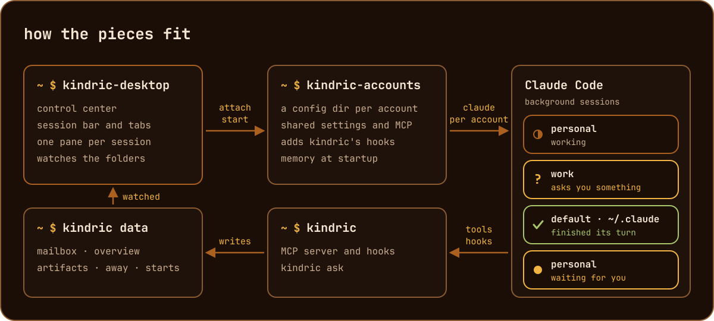

# How it works

kindric never reads the credentials of Claude Code or Codex: each keeps its own. All account handling goes through [kindric-accounts](../crates/accounts/README.md). The one exception is the key of an account whose model comes from an API key or a gateway: typed in the settings, kindric hands it to the kindric-accounts library, which keeps it in `kindric-token` in the account's directory (`600` on Linux and macOS). kindric itself keeps no copy.

## Accounts and sessions

- Accounts, isolated accounts and their directories come from the kindric-accounts library.
- Claude Code's own configuration, `~/.claude`, counts as an account named `default` when it is logged in. A plain Claude Code setup works without any kindric-accounts account.
- The session list comes from `claude agents --json` on each account, started with the same rules as `kindric-accounts run`. A Codex account is read from its daemon instead, see [Codex accounts](#codex-accounts).
- `default` is checked with `claude auth status --json` at start and at each full refresh. Its sessions are listed, attached, started and stopped with `claude` alone, without `CLAUDE_CONFIG_DIR` and without the billing variables. Claude Code then reads its own settings and MCP servers; kindric-accounts shares none with it.

## Panes

- A pane runs `kindric-accounts run <account> attach <id>` in its own pseudo-terminal. kindric builds kindric-accounts in as a library, but panes still start through the command, so it must be on your `PATH`.
- In the terminal interface, [alacritty_terminal](https://crates.io/crates/alacritty_terminal) keeps the screen and [ratatui](https://ratatui.rs) draws it. The desktop app draws with [xterm.js](https://xtermjs.org).

## New sessions

`Ctrl+N` starts `claude --bg` the way `kindric-accounts run` does (shared MCP servers, shared settings, billing variables removed), then opens the new session.

Before it starts, kindric writes down the state of the session's repository (`starts/` in its data folder), from which [Changed files](desktop.md#changed-files) compares.

Claude Code refuses to start a session in a directory the account never trusted. The form then offers **trust it**: Claude Code asks you in a window of the app, and kindric starts the session again once you press **done**. Your home directory cannot be trusted this way: Claude Code never saves that trust.

## Hooks

The sessions kindric-accounts starts get hooks that run the `kindric` command, when the `kindric` in `PATH` knows them. Claude Code reads them when a session starts, so only sessions started after kindric was installed have them.

| Hook | Event | What it does |
| --- | --- | --- |
| `kindric unread` | before each prompt, after each tool | tells the session a message is waiting |
| `kindric wait-message` | Stop, SessionStart, in the background | wakes the session when a message asks it to act now |
| `kindric away-hook` | Stop, PreToolUse, PermissionRequest | keeps the session working while you are away |
| `kindric permission-hook` | PermissionRequest | puts the question in the control center and gives back your answer |
| `kindric overview-start` | SessionStart | tells the session to ask you with `kindric ask` |
| `kindric artifact-check` | Stop | asks once to keep the files made for you |

`kindric ask "<question>" "<context>"` puts a question in the control center without stopping the session; your answer comes back as a message from you. Isolated accounts get only the hooks of absence and of the control center. Each hook is described in the [README of kindric-accounts](../crates/accounts/README.md#messages-of-kindric).

## Refresh

The list refreshes when:

- Claude Code writes to an account's `sessions/`, `daemon/` or `jobs/` directory: only that account is queried again
- a message arrives: no account is queried, only unread counts are counted again
- every 5 minutes, in case a change was missed (a session killed outright leaves its files as they were): every account is queried. Every 30 seconds when a folder could not be watched.

A burst of writes counts once: the list waits until 0.3 s pass without one, but never more than 1 s. Each query runs `claude agents --json` once per account.

Measured on Linux with two panes showing working sessions, the app's main process used about 5% of one CPU core, and its web view as much.

## Codex accounts

A Codex account (`kindric-accounts add <name> --agent codex`) has no `claude agents`, `attach` or `--bg`: Codex keeps its sessions in a daemon, one per account, which answers JSON-RPC over a WebSocket on `<account>/app-server-control/app-server-control.sock` (the protocol `codex app-server generate-json-schema` describes). The client is in kindric-accounts, `crates/accounts/src/codex.rs`.

| kindric | Codex |
| --- | --- |
| The list | The sessions loaded in the daemon (`thread/loaded/list`, then `thread/read` for their state), and the 50 used last that are not archived (`thread/list`). When the daemon does not run, `codex app-server` is started on standard input and output for the question, then ends. |
| States | `active` is working; `idle` is waiting; waiting for an approval or for an answer shows the `?` of a question; `notLoaded` is paused |
| Refresh | Codex writes `state_*.sqlite-wal` and `thread_history_*.sqlite-wal`, right in the account's directory, at each start and end of a turn and each approval asked or answered. kindric watches them like `sessions/` for Claude Code. These names are not a contract of Codex: if they change, the full refresh every 5 minutes still catches up. |
| A pane | `kindric-accounts run <account> resume <id> --remote unix://<socket>`, started in the session's folder (elsewhere, Codex first asks which folder to use). The daemon is started first when it does not run. Closing the pane ends the TUI, not the turn. |
| `Ctrl+N` | `thread/start` in the daemon, named with `thread/name/set` |
| A message from the control center | `kindric-accounts run <account> queue --thread <id> --message <text> --resume`: Codex starts a turn with it as soon as the session is free |
| `Ctrl+Shift+K` | `turn/interrupt` of the turn running, if any, then the session is hidden |
| The purge | `thread/archive`: the session leaves kindric, `codex unarchive <id>` brings it back |
| Last activity | When `<account>/sessions/<year>/<month>/<day>/rollout-<time>-<id>.jsonl` was last written |

Not yet for Codex: answering its questions in the control center, away mode, messages between sessions and kept files (the MCP server of kindric), its last steps and images, its context and limits, the task list. kindric already writes its hooks for absence and how to ask in the account's `hooks.json` (only when that file is kindric's own), and has Codex trust them, but this is not checked with a real Codex yet. Not the hook that puts questions on the page: Codex waits for it before showing the question in its TUI, which would stay blank meanwhile. Its permissions are answered in its pane. On Windows, the daemon cannot be reached yet: every Codex session shows as paused, and none can be started from kindric.

## Limits

- Mouse events are not forwarded to Claude Code.
- An interactive session started in another terminal cannot be shown in a pane: only background sessions can be attached.
- Resuming a background session with `kindric-accounts run … --bg --resume` starts a copy of it, because kindric-accounts always passes its own options. To continue the session itself, run `claude --bg --resume <id>` with no other option and `CLAUDE_CONFIG_DIR` set to the account directory.
